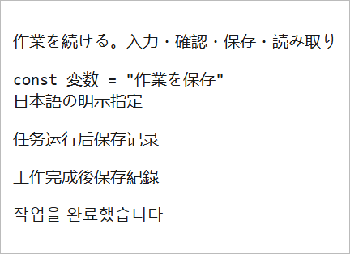
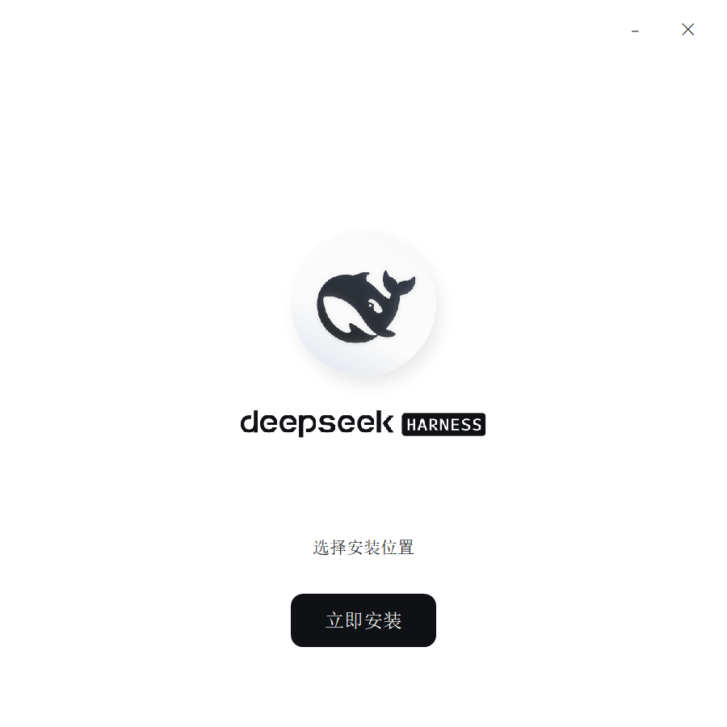

# DeepSeek Harness rc.3 日语体验修复

rc.3 的日文会话会同时遇到两个问题。界面已经切到日本語，正文和代码却仍可能使用简体中文字形。输入区的「キュー」「ステア」也没有说清消息将何时发送。本分支以官方 rc.3 为基线，修复字形选择和实际操作文案，保留上游提交历史。

在中文界面里，含假名的回复会自动使用日文字形，中文菜单继续用简体字形。需要阅读纯汉字内容或代码时，可以在字体设置中把「CJK 字形」选为日文。日文界面下，安装器、欢迎页、正文、代码和终端各自按实际显示语种选字。

[English summary](summary.en.md) · [源码差异](https://github.com/deepseek-ai/deepseek-harness/compare/38a6a5c965aa99ab525161efb7cc5cf1fe62fced...Oscar-Williams:fix/japanese-product-experience-rc3) · [固定版本 e944ab65](https://github.com/Oscar-Williams/deepseek-harness/tree/e944ab650c861cb7dc697dab718b88fdff884890)

## 效果

| 官方 rc.3 | 候选字形策略 |
| --- | --- |
|  |  |

上图是同一页面的受控对照。源码构建中的实测覆盖标题、正文、表格、代码和设置重载，具体平台及绘制字形见[验证记录](verification.md)。

本次验收在 Windows 完成，包括已安装 Edge 的真实日语输入法与网页翻译、Chrome 和 Firefox 字形、终端连接、隔离 Desktop 欢迎页，以及日语和简体安装器。

| Windows 日文安装器 | 同批的简体安装器 |
| --- | --- |
|  |  |

> 「目標をクリア」改为「目標を解除」。“仍可继续”的目标显示「再開待ちの目標」。待发消息采用「送信待ち」，操作「実行中のタスクに指示を追加」说明指令会进入当前任务。

[日文改词表](ja-copy-review.md)逐项给出字典键、原文、新文案与操作语境，可单独交给日语评审。

## 提交与采用

发布基线为 [dsh-v0.2.2-rc.3](https://github.com/deepseek-ai/deepseek-harness/releases/tag/dsh-v0.2.2-rc.3) 的 `38a6a5c965aa99ab525161efb7cc5cf1fe62fced`。完整候选为 `e944ab650c861cb7dc697dab718b88fdff884890`。按表中顺序应用可重建完整修复。术语改词可以单独审阅。字体策略、正文标记和验收用例按依赖顺序采用。

| 提交 | 改动 | 补丁 |
| --- | --- | --- |
| [ef05a743](https://github.com/Oscar-Williams/deepseek-harness/commit/ef05a7432ca246910c1567684715beb68a00726a) | 共享地区字体与轨迹表 | [.patch](https://github.com/Oscar-Williams/deepseek-harness/commit/ef05a7432ca246910c1567684715beb68a00726a.patch) |
| [a135042a](https://github.com/Oscar-Williams/deepseek-harness/commit/a135042a63c0637a3d80bbfc9165b786dd2bab40) | 桌面独立窗口和原生安装器 | [.patch](https://github.com/Oscar-Williams/deepseek-harness/commit/a135042a63c0637a3d80bbfc9165b786dd2bab40.patch) |
| [0da519cb](https://github.com/Oscar-Williams/deepseek-harness/commit/0da519cb87e241d9ed784b40a184531d0c28d529) | 终端字体与连接连续性 | [.patch](https://github.com/Oscar-Williams/deepseek-harness/commit/0da519cb87e241d9ed784b40a184531d0c28d529.patch) |
| [00f99015](https://github.com/Oscar-Williams/deepseek-harness/commit/00f99015c0f769186d274ec4a0d7ad83da3da9c6) | 输入区浏览器翻译保护 | [.patch](https://github.com/Oscar-Williams/deepseek-harness/commit/00f99015c0f769186d274ec4a0d7ad83da3da9c6.patch) |
| [548b7d1c](https://github.com/Oscar-Williams/deepseek-harness/commit/548b7d1c3f058b0a506cdf01db4ec3884aae32c6) | 启动与日文输入文案 | [.patch](https://github.com/Oscar-Williams/deepseek-harness/commit/548b7d1c3f058b0a506cdf01db4ec3884aae32c6.patch) |
| [7957e216](https://github.com/Oscar-Williams/deepseek-harness/commit/7957e21668172aaf968787cd2981c20539e75bed) | 逐个界面完善 Client 与插件文案 | [.patch](https://github.com/Oscar-Williams/deepseek-harness/commit/7957e21668172aaf968787cd2981c20539e75bed.patch) |
| [932a2cc0](https://github.com/Oscar-Williams/deepseek-harness/commit/932a2cc0571ffe9ee2593a071ce10fed5e4cfd55) | 统一地区字体、新设置及双语说明 | [.patch](https://github.com/Oscar-Williams/deepseek-harness/commit/932a2cc0571ffe9ee2593a071ce10fed5e4cfd55.patch) |
| [78e27084](https://github.com/Oscar-Williams/deepseek-harness/commit/78e27084b0ca9682dbc65272a7c842230b8f6972) | 正文假名推断及流式渲染 | [.patch](https://github.com/Oscar-Williams/deepseek-harness/commit/78e27084b0ca9682dbc65272a7c842230b8f6972.patch) |
| [c21dc6e8](https://github.com/Oscar-Williams/deepseek-harness/commit/c21dc6e81caa6148a006e9fcb8609d61ed381eee) | 词条和字体归属检查 | [.patch](https://github.com/Oscar-Williams/deepseek-harness/commit/c21dc6e81caa6148a006e9fcb8609d61ed381eee.patch) |
| [004300e4](https://github.com/Oscar-Williams/deepseek-harness/commit/004300e4225e46c63c20eaff0304f39ec38e26dc) | 浏览器字形回归与手动工作流 | [.patch](https://github.com/Oscar-Williams/deepseek-harness/commit/004300e4225e46c63c20eaff0304f39ec38e26dc.patch) |
| [870fcec9](https://github.com/Oscar-Williams/deepseek-harness/commit/870fcec9cd399f345a5f857f7c9e4b6cf354609e) | 状态提示及文本预览采用主题字体 | [.patch](https://github.com/Oscar-Williams/deepseek-harness/commit/870fcec9cd399f345a5f857f7c9e4b6cf354609e.patch) |
| [6896be77](https://github.com/Oscar-Williams/deepseek-harness/commit/6896be77b03f0fe03e1042600dc1b58d6b51b6b7) | 使用已有 Chromium 的录制回放 | [.patch](https://github.com/Oscar-Williams/deepseek-harness/commit/6896be77b03f0fe03e1042600dc1b58d6b51b6b7.patch) |
| [c8fd4381](https://github.com/Oscar-Williams/deepseek-harness/commit/c8fd4381be0114f81f289323957a42998e307bbb) | 同步预装插件目录日文简介 | [.patch](https://github.com/Oscar-Williams/deepseek-harness/commit/c8fd4381be0114f81f289323957a42998e307bbb.patch) |
| [e944ab65](https://github.com/Oscar-Williams/deepseek-harness/commit/e944ab650c861cb7dc697dab718b88fdff884890) | Install Playwright browsers from the Web workspace | [.patch](https://github.com/Oscar-Williams/deepseek-harness/commit/e944ab650c861cb7dc697dab718b88fdff884890.patch) |

[技术说明](technical-review.zh.md)解释设置优先级、内容边界和社区方案的交集。[复现步骤](repro/README.md)用于检出候选、验证原生安装器和重跑字体用例。版本采用与发布签名由官方维护者确认。
