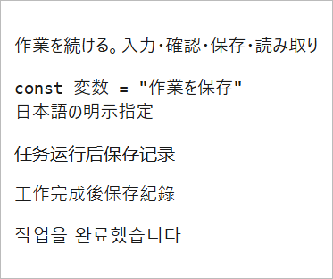
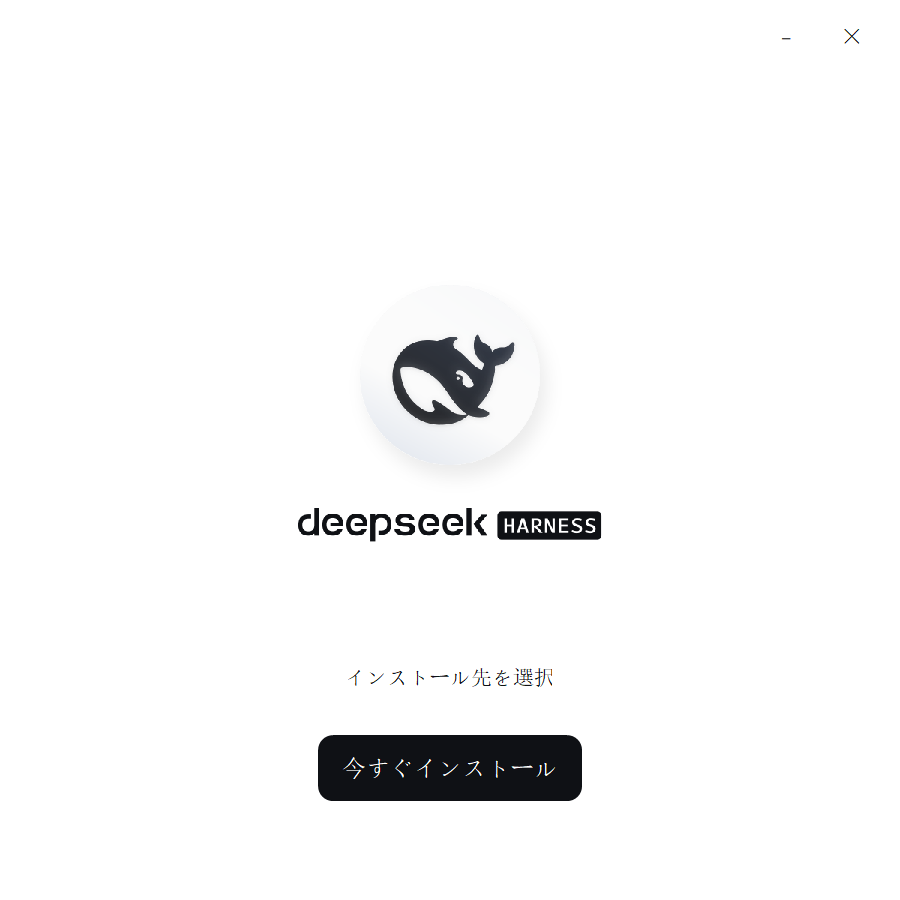

# DeepSeek Harness rc.3 日语体验修复

本次修复基于 DeepSeek Harness `dsh-v0.2.2-rc.3` 源码开发。Windows 实机验收使用加入修复后构建的 rc.3。在官方发布的 rc.3 中，界面切到日本語后，正文和代码仍可能使用简体中文字形。输入区的「キュー」「ステア」也让人难以判断消息会等待发送，还是会立即追加到正在运行的任务。

修复后，中文界面的菜单继续使用简体字形，含假名的日文回复可自动用日文字形。需要阅读纯汉字内容或代码时，可以在字体设置中把「CJK 字形」选为日文。切到日语界面后，正文、代码和终端默认使用日文字形。独立欢迎页跟随窗口语言，Windows 安装器跟随安装时选中的语言。

[English summary](summary.en.md) · [与官方 rc.3 的源码差异](https://github.com/deepseek-ai/deepseek-harness/compare/38a6a5c965aa99ab525161efb7cc5cf1fe62fced...Oscar-Williams:fix/japanese-product-experience-rc3) · [待审阅源码 e944ab65](https://github.com/Oscar-Williams/deepseek-harness/tree/e944ab650c861cb7dc697dab718b88fdff884890)

## 效果

| 官方 rc.3 字体设置 | rc.3 加入修复后的字体设置 |
| --- | --- |
|  |  |

上图在同一页面中分别应用官方 rc.3 和修复后的字体规则。Windows 实机还检查了 Chrome 和 Firefox 中实际绘制的字体、Edge 中日语输入法与网页翻译、切换字形时的终端连接，以及独立桌面窗口和原生安装器。[Windows 验收记录](verification.md)

| Windows 日文安装器 | 同批的简体安装器 |
| --- | --- |
|  |  |

> 「目標をクリア」改为「目標を解除」。“仍可继续”的目标显示「再開待ちの目標」。待发消息采用「送信待ち」，操作「実行中のタスクに指示を追加」说明指令会进入当前任务。

[日文改词表](ja-copy-review.md)逐项给出字典键、原文、新文案与操作语境，可单独交给日语评审。

## 提交与采用

从官方 rc.3 的 `38a6a5c965aa99ab525161efb7cc5cf1fe62fced` 开始，按下表顺序应用补丁，可得到待审阅提交 `e944ab650c861cb7dc697dab718b88fdff884890`。文案可以单独审阅。字体相关改动先应用共享策略，再应用正文识别和对应检查。[官方 rc.3 发布页](https://github.com/deepseek-ai/deepseek-harness/releases/tag/dsh-v0.2.2-rc.3)

| 提交 | 改动 | 补丁 |
| --- | --- | --- |
| [ef05a743](https://github.com/Oscar-Williams/deepseek-harness/commit/ef05a7432ca246910c1567684715beb68a00726a) | 共享地区字体与轨迹表 | [.patch](https://github.com/Oscar-Williams/deepseek-harness/commit/ef05a7432ca246910c1567684715beb68a00726a.patch) |
| [a135042a](https://github.com/Oscar-Williams/deepseek-harness/commit/a135042a63c0637a3d80bbfc9165b786dd2bab40) | 桌面独立窗口和原生安装器 | [.patch](https://github.com/Oscar-Williams/deepseek-harness/commit/a135042a63c0637a3d80bbfc9165b786dd2bab40.patch) |
| [0da519cb](https://github.com/Oscar-Williams/deepseek-harness/commit/0da519cb87e241d9ed784b40a184531d0c28d529) | 终端字体与连接连续性 | [.patch](https://github.com/Oscar-Williams/deepseek-harness/commit/0da519cb87e241d9ed784b40a184531d0c28d529.patch) |
| [00f99015](https://github.com/Oscar-Williams/deepseek-harness/commit/00f99015c0f769186d274ec4a0d7ad83da3da9c6) | 输入区浏览器翻译保护 | [.patch](https://github.com/Oscar-Williams/deepseek-harness/commit/00f99015c0f769186d274ec4a0d7ad83da3da9c6.patch) |
| [548b7d1c](https://github.com/Oscar-Williams/deepseek-harness/commit/548b7d1c3f058b0a506cdf01db4ec3884aae32c6) | 启动与日文输入文案 | [.patch](https://github.com/Oscar-Williams/deepseek-harness/commit/548b7d1c3f058b0a506cdf01db4ec3884aae32c6.patch) |
| [7957e216](https://github.com/Oscar-Williams/deepseek-harness/commit/7957e21668172aaf968787cd2981c20539e75bed) | 逐个界面完善 Client 与插件文案 | [.patch](https://github.com/Oscar-Williams/deepseek-harness/commit/7957e21668172aaf968787cd2981c20539e75bed.patch) |
| [932a2cc0](https://github.com/Oscar-Williams/deepseek-harness/commit/932a2cc0571ffe9ee2593a071ce10fed5e4cfd55) | 统一地区字体、新设置及双语说明 | [.patch](https://github.com/Oscar-Williams/deepseek-harness/commit/932a2cc0571ffe9ee2593a071ce10fed5e4cfd55.patch) |
| [78e27084](https://github.com/Oscar-Williams/deepseek-harness/commit/78e27084b0ca9682dbc65272a7c842230b8f6972) | 正文假名推断及流式渲染 | [.patch](https://github.com/Oscar-Williams/deepseek-harness/commit/78e27084b0ca9682dbc65272a7c842230b8f6972.patch) |
| [c21dc6e8](https://github.com/Oscar-Williams/deepseek-harness/commit/c21dc6e81caa6148a006e9fcb8609d61ed381eee) | 词条和字体归属检查 | [.patch](https://github.com/Oscar-Williams/deepseek-harness/commit/c21dc6e81caa6148a006e9fcb8609d61ed381eee.patch) |
| [004300e4](https://github.com/Oscar-Williams/deepseek-harness/commit/004300e4225e46c63c20eaff0304f39ec38e26dc) | 浏览器字形回归与手动工作流 | [.patch](https://github.com/Oscar-Williams/deepseek-harness/commit/004300e4225e46c63c20eaff0304f39ec38e26dc.patch) |
| [870fcec9](https://github.com/Oscar-Williams/deepseek-harness/commit/870fcec9cd399f345a5f857f7c9e4b6cf354609e) | 状态提示及文本预览采用主题字体 | [.patch](https://github.com/Oscar-Williams/deepseek-harness/commit/870fcec9cd399f345a5f857f7c9e4b6cf354609e.patch) |
| [6896be77](https://github.com/Oscar-Williams/deepseek-harness/commit/6896be77b03f0fe03e1042600dc1b58d6b51b6b7) | 使用已有 Chromium 的录制回放 | [.patch](https://github.com/Oscar-Williams/deepseek-harness/commit/6896be77b03f0fe03e1042600dc1b58d6b51b6b7.patch) |
| [c8fd4381](https://github.com/Oscar-Williams/deepseek-harness/commit/c8fd4381be0114f81f289323957a42998e307bbb) | 同步预装插件目录日文简介 | [.patch](https://github.com/Oscar-Williams/deepseek-harness/commit/c8fd4381be0114f81f289323957a42998e307bbb.patch) |
| [e944ab65](https://github.com/Oscar-Williams/deepseek-harness/commit/e944ab650c861cb7dc697dab718b88fdff884890) | 从 Web 工作区安装 Playwright 浏览器 | [.patch](https://github.com/Oscar-Williams/deepseek-harness/commit/e944ab650c861cb7dc697dab718b88fdff884890.patch) |

[技术说明](technical-review.zh.md)解释字体设置的优先级，以及正文如何确定字形。[复现步骤](repro/README.md)列出检出、构建、运行 Web 和检查 Windows 原生安装器的命令。
