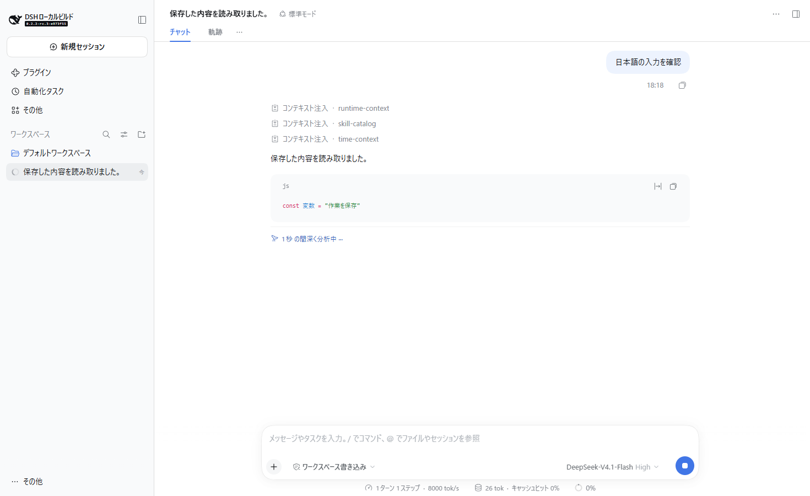

# DeepSeek Harness rc.3 日语体验修复

rc.3 的日语界面仍会在正文和代码中优先使用简体中文字形，Windows 安装器也有同类字体硬编码。本次修复把字体选择接到界面语言和内容语言标记，同时处理安装按钮裁字、终端语言切换、输入区翻译保护和常用日文措辞。

[English summary](summary.en.md) · [源码分支](https://github.com/Oscar-Williams/deepseek-harness/tree/fix/japanese-product-experience-rc3) · [从官方 rc.3 查看完整改动](https://github.com/deepseek-ai/deepseek-harness/compare/38a6a5c965aa99ab525161efb7cc5cf1fe62fced...Oscar-Williams:fix/japanese-product-experience-rc3)

本分支用于审阅修复效果和采用方法。Fork 默认分支提供完整源码、上游 README、许可证及贡献指南；维护者可从下方五个提交按需摘取改动。

## 效果对照

| 官方 rc.3 | 同一页面加载候选主题 |
| --- | --- |
|  |  |

Windows Edge 的实际字体记录中，日文正文和代码从 Microsoft YaHei 改用 Yu Gothic UI，代码中的拉丁字符继续使用 Consolas。这组截图使用同一安装版页面作受控对照；[验证记录](verification.md#字体选择)列出简体、繁体、韩文及显式语种内容的实际结果。

独立运行的候选构建还完成了日文输入、消息发送和真实 cmd 终端的语言切换。下图的回复由本地流式模型夹具提供。

| 日文安装器 | 简体安装器 |
| --- | --- |
|  |  |

## 提交与采用

| 提交 | 改动 | 单项补丁 |
| --- | --- | --- |
| [`ef05a743`](https://github.com/Oscar-Williams/deepseek-harness/commit/ef05a7432ca246910c1567684715beb68a00726a) | 共享地区字体与轨迹表 | [下载 .patch](https://github.com/Oscar-Williams/deepseek-harness/commit/ef05a7432ca246910c1567684715beb68a00726a.patch) |
| [`a135042a`](https://github.com/Oscar-Williams/deepseek-harness/commit/a135042a63c0637a3d80bbfc9165b786dd2bab40) | 桌面独立窗口、Windows 安装器和按钮排版 | [下载 .patch](https://github.com/Oscar-Williams/deepseek-harness/commit/a135042a63c0637a3d80bbfc9165b786dd2bab40.patch) |
| [`0da519cb`](https://github.com/Oscar-Williams/deepseek-harness/commit/0da519cb87e241d9ed784b40a184531d0c28d529) | 终端字体、语言切换与 Nerd Font 候选 | [下载 .patch](https://github.com/Oscar-Williams/deepseek-harness/commit/0da519cb87e241d9ed784b40a184531d0c28d529.patch) |
| [`00f99015`](https://github.com/Oscar-Williams/deepseek-harness/commit/00f99015c0f769186d274ec4a0d7ad83da3da9c6) | 输入区浏览器翻译保护 | [下载 .patch](https://github.com/Oscar-Williams/deepseek-harness/commit/00f99015c0f769186d274ec4a0d7ad83da3da9c6.patch) |
| [`548b7d1c`](https://github.com/Oscar-Williams/deepseek-harness/commit/548b7d1c3f058b0a506cdf01db4ec3884aae32c6) | 启动、欢迎页和输入区日文措辞 | [下载 .patch](https://github.com/Oscar-Williams/deepseek-harness/commit/548b7d1c3f058b0a506cdf01db4ec3884aae32c6.patch) |

发布基线为 [dsh-v0.2.2-rc.3](https://github.com/deepseek-ai/deepseek-harness/releases/tag/dsh-v0.2.2-rc.3)，提交 `38a6a5c965aa99ab525161efb7cc5cf1fe62fced`；修复终点为 `548b7d1c3f058b0a506cdf01db4ec3884aae32c6`。五个提交均已从该基线检查单项应用，整组得到同一棵最终树。直接检出和 cherry-pick 的命令见[复现步骤](repro/README.md#检出或选取提交)。

## 审阅材料

- [技术说明](technical-review.zh.md)：问题来源、实际修改入口与已有社区方案的重叠。
- [验证记录](verification.md)：环境、实际字体、会话与终端、桌面与安装器、构建测试，以及发布复验项目。
- [日文改词表](ja-copy-review.md)：14 项文案的原文、新文案和界面语境。
- [复现步骤](repro/README.md)：检出、构建、定向测试与原生样例的操作方法。

代码保留上游结构和协作文件。采用与发布范围由官方团队审阅确定；[官方贡献指南](https://github.com/deepseek-ai/deepseek-harness/blob/38a6a5c965aa99ab525161efb7cc5cf1fe62fced/CONTRIBUTING.zh.md)仍是对接依据。
