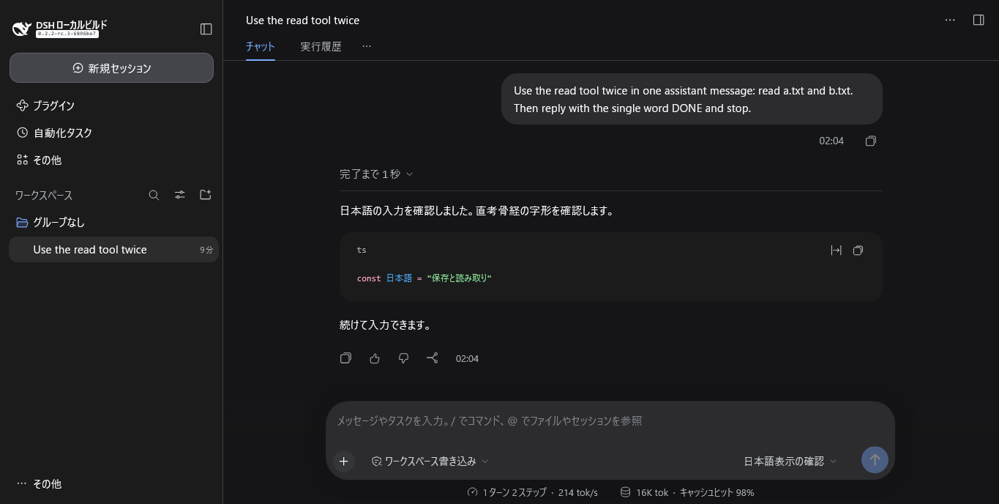

# rc.3 验收记录

Windows 实机验收使用加入修复后构建的 `dsh-v0.2.2-rc.3`。Web 和桌面欢迎页使用 `6896be77` 的构建产物。环境为 Windows 11 x64，构建使用 Node.js 24.19.0 和 pnpm 11.28.5。[实机验收构建对应的源码](https://github.com/Oscar-Williams/deepseek-harness/commit/6896be77b03f0fe03e1042600dc1b58d6b51b6b7)

插件目录同步后，Edge 会话与终端脚本在 `e944ab65` 上也通过了复验。随后补齐 Noto 地区字形和在线回归，当前待审阅源码为 `e0e5bdeb`。下列 Windows 记录和 CI 矩阵分别标明了所用的构建。[待审阅源码](https://github.com/Oscar-Williams/deepseek-harness/commit/e0e5bdeba6f8790bef937baddcc203a4bc2fca8c)

## Web 字形与设置

| 场景 | 浏览器和取证方法 | 结果 |
| --- | --- | --- |
| rc.3 的日文正文与代码 | Edge 157，同一页面分别应用两套字体规则，用 DevTools 统计实际绘制的字体 | 日文从 Microsoft YaHei 切到 Yu Gothic UI，拉丁代码保留 Consolas。简体、繁体、韩文分别检查 Microsoft YaHei、Microsoft JhengHei UI 和 Malgun Gothic。 |
| 日文界面的标题、正文、表格与代码 | Chrome 157.0.8103.51，源码构建，DevTools 实际绘制统计及同元素像素对照 | 四处均绘制 Yu Gothic UI，分别为 15、17、13、4 个字形。 |
| 中文界面中的日文回复 | Chrome 157，同一回复用日文和简体系统字体作正负对照 | 含假名的正文匹配日文对照。中文控件与未标注的纯汉字仍采用简体。 |
| 中文界面手动选日文 | Chrome 157，纯汉字像素对照、代码字体及重载 | 控件保留简体，纯汉字正文与代码采用日文候选。重载后选择仍生效。 |
| 英文界面、浏览器日语优先 | Chrome 157，未标注汉字像素对照 | 自动选择日文候选。现有 Edge 日语偏好也在候选页面的浏览器语言列表中排首位。 |
| 显式语种、嵌套和用户字体 | Chrome 157，受控内容子树和真实组件，另有 Markdown 测试 | `zh-Hant`、`ko` 采用各自的回退。内层 `en` 以该环境的内容默认地区绘制。自定义字体在像素对照中优先。 |
| Windows Firefox 正文与代码 | Firefox 160.0，独立配置，WebDriver BiDi 对同一个元素逐次取样 | 两处实际像素均与 Yu Gothic UI 相同，与 Microsoft YaHei 对照不同。两种字体先通过本机字体加载验证。 |
| 执行履历表 | Edge 157，DevTools 统计可见文字节点 | 「初期システムプロンプト」等实际绘制 Yu Gothic UI，「ターン 1」中的拉丁数字同时使用 Consolas。 |

Chrome 和 Firefox 均连接本机单独启动的 DSH Web 服务，回放预先录制的样例会话。独立测试目录保存本轮会话和设置。字体测试核对候选名单及顺序，Markdown 测试检查显式语种、流式更新、代码语言标识和原始 HTML 的处理。

## 会话、输入和终端

用构建后的 CLI 单独启动 DSH Web 服务，工作区和输入均使用测试数据。测试服务通过本机连接流式返回样例回复。自动化用例用 Chromium DevTools 模拟输入组合事件，确认「日本語の入力を確認」后再发送，核对收到的日文正文和代码。

另用 Windows 的 Microsoft 日语输入法在 Edge 输入 `nihongo`，按空格转换，再按 Enter 确认「日本語」。此时草稿仍在输入框，模型请求为 0，可以继续输入。点击发送后，测试服务收到 1 次请求并流式返回日文回复。[确认后的草稿](evidence/windows-edge-ime-draft.png)

Edge 内置翻译将会话标题和滚入可见区的英文消息译成日文。输入框里的英文草稿与工具栏的 Workspace Write 保留原文。[翻译后的会话](evidence/windows-edge-translation.png)

在同一个 Windows cmd 终端中，日语自动、简体自动、简体界面手动指定日文依次实际绘制 Yu Gothic UI、Microsoft YaHei、Yu Gothic UI。Consolas 全程绘制拉丁字符。三个状态复用同一个 xterm 节点，切换后进程中的变量仍在并输出 `still-17349`。

[同一个 Windows cmd 终端的输出](evidence/web-terminal-switch.png)

## 桌面与安装器

正常退出已安装的 DSH 后，用独立的 `DSH_HOME` 和 Electron 用户数据目录启动 rc.3 修复构建。Electron 44.7.0 的日文欢迎标题实际绘制 Yu Gothic UI Light，登录与 API Key 按钮绘制 Yu Gothic UI Semibold。[实测欢迎页](evidence/windows-desktop-welcome.png)

登录等待页和普通更新窗口的截图来自 rc.3 的 `548b7d1c` 构建，对应窗口代码和日文资源在待审阅提交中保持一致。强制更新窗口的命令地址框现在使用统一的代码字体，相应用例已通过。[登录等待页](evidence/electron-after-login-ja.png)

原生安装器从 rc.3 的 `548b7d1c` 构建，使用项目的 NSIS 配置、测试产品标识和模拟载荷。待审阅提交使用相同的安装器源码。日语及简体各通过 16 项检查，覆盖路径校验、安装完成、进程占用、静默更新和卸载。150% 缩放下「今すぐインストール」完整显示。原生进度和重启提示另用独立样例检查。GDI 在日语安装器中选中 Yu Gothic UI，在简体安装器中选中 Microsoft YaHei UI。

## 构建、检查与记录回放

| 检查 | 结果 |
| --- | --- |
| `build:artifacts --serial`、`build:check --serial` | 8 项构建、2 项聚合类型检查通过，产物用于 Windows 浏览器实测。 |
| Chromium 录制回放与字形场景 | 2 项通过。录制回放恢复持久化记录，核对日文提示及「実行履歴」标签。 |
| 定向 Vitest、字典键和占位符 | 537 个不同的定向用例通过。安装器依赖加载用例通过了独立重试。29 个语言键和区域资源用例通过。 |
| `verify-client-ui-i18n` 与 `verify-japanese-experience` | 1318 个 Client 文件的文案归属、63 份词典和 266 份样式的专项检查通过。 |
| 配置、文案与双语说明 | 配置目录、Cordis 检查目录、插件目录、双语配对及文档站构建通过。 |
| fork 推送前检查 | 5 项类型检查通过。 |
| 固定补丁 | 合并 diff 和按序应用的 17 份补丁均从 rc.3 重建待审阅提交 `e0e5bdeb` 的源码。 |

## macOS 与 Ubuntu 的 CI 回归

工作流从修复后的 rc.3 源码 `e0e5bdeb` 构建。每个引擎都检查正文、标题、表格、代码、手动地区和显式语种。在同一元素上绘制日文、简体两个参照，要求两者像素不同，并要求应用当前绘制结果匹配预期参照。英文界面和英文浏览器偏好下的日文段落覆盖了 #9516 描述的字形问题。[原始反馈](https://github.com/deepseek-ai/deepseek-harness/discussions/9516)

| 运行器 | 字形 | 会话回放 |
| --- | --- | --- |
| [`ubuntu-latest`（Ubuntu 26.04）](https://github.com/Oscar-Williams/deepseek-harness/actions/runs/43949736750/job/133588743200) | Firefox 151.0、WebKit 26.5 和 Chromium 149.0.7827.55 均通过，每个引擎 12 组像素对照。日文与简体参照为 Noto Sans CJK JP 和 Noto Sans CJK SC。 | 日语 Web 会话、CLI 的 `text-turn` 和 `parallel-tool-calls` 均通过。 |
| [`macos-latest`](https://github.com/Oscar-Williams/deepseek-harness/actions/runs/43949736750/job/133610962559) | GitHub 三次在排队阶段因 ARM64 运行器容量不足取消。字形用例待运行。 | 日语 Web 会话和两份 CLI 录制待运行。 |

三次尝试均保留了同一提交的 Ubuntu 结果，macOS 分配到运行器后可单独完成余下验证。[GitHub Actions 测试报告](https://github.com/Oscar-Williams/deepseek-harness/actions/runs/43949736750) · [macOS 首次作业](https://github.com/Oscar-Williams/deepseek-harness/actions/runs/43949736750/job/133588742498) · [第二次作业](https://github.com/Oscar-Williams/deepseek-harness/actions/runs/43949736750/job/133600171049)
