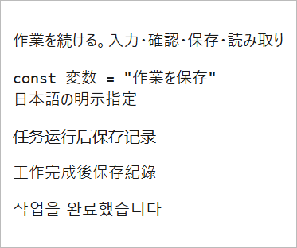
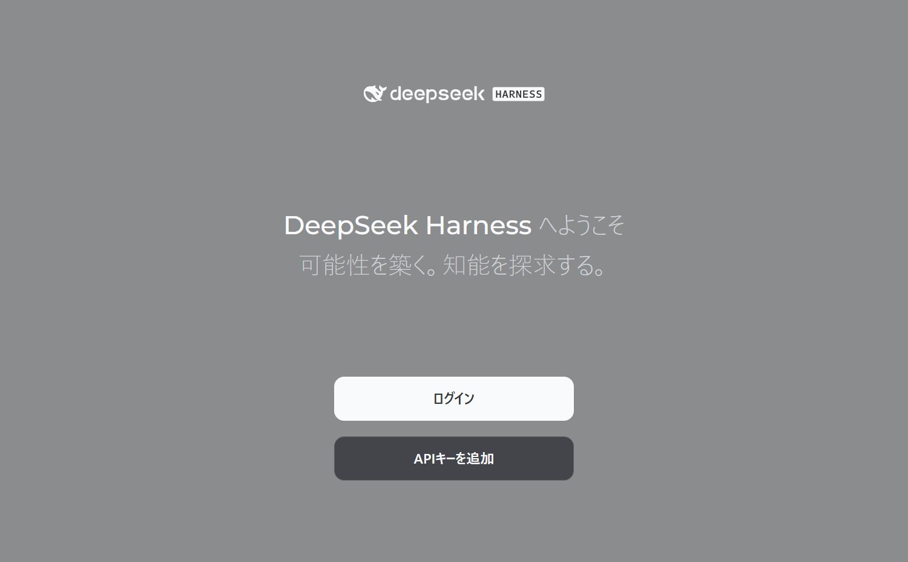
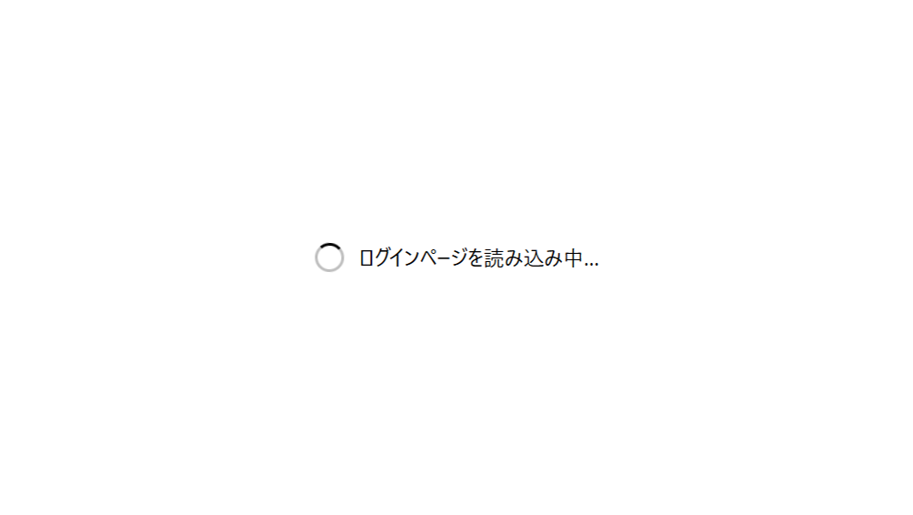

# rc.3 验证记录

本记录对应 Windows 上已经完成的检查。源码分支为 [fix/japanese-product-experience-rc3](https://github.com/Oscar-Williams/deepseek-harness/tree/fix/japanese-product-experience-rc3)，发布基线为 [38a6a5c965aa99ab525161efb7cc5cf1fe62fced](https://github.com/deepseek-ai/deepseek-harness/commit/38a6a5c965aa99ab525161efb7cc5cf1fe62fced)，提交终点为 [548b7d1c3f058b0a506cdf01db4ec3884aae32c6](https://github.com/Oscar-Williams/deepseek-harness/commit/548b7d1c3f058b0a506cdf01db4ec3884aae32c6)。检查日期为 2026-11-16。

## 版本与范围

| 项目 | 实际环境或取值 |
| --- | --- |
| 操作系统 | Windows 11 x64 |
| 官方安装包 | `@deepseek-ai/dsh@0.2.2-rc.3` |
| 浏览器 | Microsoft Edge 157.0.4341.60 |
| 构建工具 | Node.js 24.19.0、pnpm 11.28.5；最多两个构建任务并行 |
| 产品源码 | 已运行构建的提交为 `e973f55ef196c6dc57ba2942faee9ffe097ad862`。最终提交补充录制会话测试、测试编译配置和日文 UI 预期输出，产品源文件与该构建逐项一致。 |
| 原生输入文件 | 安装器、独立窗口渲染器、安装脚本、登录等待和桌面语言文件与已运行原生样例逐项一致。 |

下表中的浏览器字体来自 DevTools 协议的 `CSS.getPlatformFontsForNode`。官方页面与候选主题使用同一安装版页面作受控对照；另一次验证通过构建后的正常 CLI 启动候选 Web Host。

## 字体选择

| 内容 | 官方 rc.3 | 同页加载候选主题 |
| --- | --- | --- |
| 日文正文 | Microsoft YaHei，20 个字形 | Yu Gothic UI，20 个字形 |
| 代码中的日文 | Microsoft YaHei，7 个字形 | Yu Gothic UI，7 个字形 |
| 代码中的拉丁字符 | Consolas，11 个字形 | Consolas，11 个字形 |
| 显式标记为日文的内容 | Microsoft YaHei，8 个字形 | Yu Gothic UI，8 个字形 |
| 简体中文 | Microsoft YaHei，9 个字形 | Microsoft YaHei，9 个字形 |
| 繁体中文 | Microsoft YaHei，9 个字形 | Microsoft JhengHei UI，9 个字形 |
| 韩文 | Malgun Gothic，9 个字形；Segoe UI，1 个字形 | Malgun Gothic，10 个字形 |

字体候选测试同时检查字体名称存在及其优先顺序。日文系统字体、日文 Noto 和最终系统回退均有明确位置。实际组件继续使用共享主题中的正文与代码字体变量。

| 官方页面 | 候选主题 |
| --- | --- |
|  |  |

## 会话与终端

候选 Web Host 使用隔离的 home、工作区和浏览器 context；模型回复由本机回环地址上的流式夹具提供。Chromium 组合事件依次记录为空输入、`にほんご`、`日本語の入力を確認`，随后结束组合并提交完整文本。编辑器和工具栏均继承输入区的翻译保护，助手正文保留翻译资格，回复中的代码正常显示。

真实 Windows cmd 终端在日语界面使用 Yu Gothic UI；切换为简体后使用 Microsoft YaHei，拉丁字符持续使用 Consolas。切换前后保持同一组 xterm DOM 节点，已设置的进程变量继续有效，终端接受后续命令并输出 `still-17349`。

录制会话测试通过仓库已有的持久化接口恢复日志，核对输入区的日文提示和操作文案。该项测试共 1 个用例，通过；耗时 13.68 秒。

## 桌面与安装器

Electron 的欢迎页和登录等待页选中 Yu Gothic UI。普通与强制更新窗口的字体读取也选中对应日文字体；窗口状态来自隔离 IPC 夹具。

| 欢迎页 | 登录等待页 |
| --- | --- |
|  |  |

上游生产 NSIS 安装器使用独立测试产品标识和模拟载荷，日文与简体各通过以下 16 项检查：

| 检查 | 日文 | 简体 |
| --- | --- | --- |
| 首次显示欢迎页 | 通过 | 通过 |
| 所有权检查前拒绝盘符根路径 | 通过 | 通过 |
| Enter 校验当前路径，并保留未勾选的启动状态 | 通过 | 通过 |
| 完成页保留窗口位置 | 通过 | 通过 |
| 首次显示前欢迎页已就绪 | 通过 | 通过 |
| 成功安装先绘制 100% 再显示完成页 | 通过 | 通过 |
| 锁定目录提示错误和复制操作，并保留既有安装 | 通过 | 通过 |
| 处理注册目录末尾分隔符 | 通过 | 通过 |
| 注册目录与勾选启动 | 通过 | 通过 |
| 启动失败重试及关闭提示 | 通过 | 通过 |
| 欢迎及解压前拒绝正在运行的应用 | 通过 | 通过 |
| 静默模式解压前拒绝正在运行的应用 | 通过 | 通过 |
| 拒绝欢迎页显示后启动的应用 | 通过 | 通过 |
| 静默更新保留目录，并忽略无关进程 | 通过 | 通过 |
| 拒绝无效目标目录 | 通过 | 通过 |
| 卸载 | 通过 | 通过 |

在 150% 显示缩放下，“今すぐインストール”完整显示。原生进度和重启提示夹具成功运行。GDI 字体解析中，日文请求 Yu Gothic UI 并实际得到同名字体；简体请求 Microsoft YaHei UI 并实际得到同名字体。

| 日文 | 简体 |
| --- | --- |
|  |  |

## 构建与测试

| 检查 | 结果 |
| --- | --- |
| `corepack pnpm run build --serial` | 10 项全部通过，耗时 537.68 秒 |
| 八个定向 Vitest 文件 | 238 项全部通过，耗时 43.32 秒 |
| 已保存会话的浏览器回放 | 1 项通过 |
| 五份双语 README 配对 | 全部一致 |
| `verify-client-ui-i18n` | 1315 个 Client UI 源文件通过文案归属检查 |
| 最终代码推送时的原有 pre-push 检查 | Host Typert、Host 编译、Client 编译、Host 聚合和 Client 聚合共 5 项通过 |

构建的十项为原生插件、Host Typert、Host 编译、Host bundle、Desktop bundle、Client 编译、Client bundle、Web 构建、Host 聚合和 Client 聚合。定向测试的文件清单及执行命令见[复现步骤](repro/README.md#定向测试和已保存会话)。

## 补丁应用

五个提交分别在固定 rc.3 基线上试应用，均可独立应用。整组提交与合并差异也还原相同的最终树：`175ee618fdf8ba12226643ff08cbb29f64b9ec56`。提交入口及单项补丁下载见[审阅说明](README.md#提交与采用)。

## 发布复验

| 环境 | 需要观察的结果 |
| --- | --- |
| macOS Firefox | 按原反馈检查正文、代码及显式语种内容，确认实际字体来自日文字库 |
| Windows 系统日语 IME 与浏览器翻译 | 候选词确认、Enter 和连续输入正常；输入区受保护，会话正文可翻译 |
| 安装了 Nerd Font 的系统 | 终端专用图标正确绘制，拉丁及日文保持对应字体 |
| 签名多语言安装包 | 在团队原有分发流程中完成安装、升级、卸载和重启提示检查 |

本次浏览器输入证据使用 Chromium 组合事件。安装器证据使用上述隔离样例；签名发布包按团队的既有发布流程复验。
